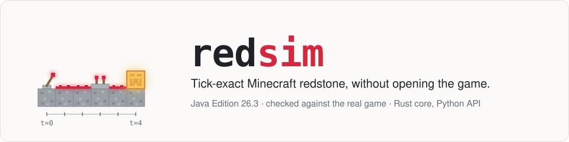

<p align="center">
  <picture>
    <source media="(prefers-color-scheme: dark)" srcset="docs/img/banner-dark.svg">
    
  </picture>
</p>

<p align="center">
  <a href="../../actions/workflows/tests.yml"></a>
  
  
  
  <a href="LICENSE"></a>
</p>

**redsim** runs Minecraft Java Edition redstone builds (doors, logic, clocks, piston machines, item
handling) from code, without opening the game. It does every block update in the same order as the
game, so timing, quasi-connectivity, 0-ticks and even the position-dependent quirks come out exactly
as they would in your world. Every simulated behaviour is checked against the real game, tick by
tick.

It's built for people and AI agents who design, test and debug redstone: load a schematic or build
in Python, flip a lever, and get back exactly what happened, when, and why.

```python
import redsim as rs

w = rs.World(trace=True)
w.fill((0, 0, 0), (5, 0, 0), "stone")
w.set((0, 1, 0), "lever[face=floor,facing=east]")
w.wire((1, 1, 0), (2, 1, 0))
w.set((3, 1, 0), "repeater[facing=west,delay=2]")
w.wire((4, 1, 0))
w.set((5, 1, 0), "redstone_lamp")

tl = w.record(10, inputs={0: lambda w: w.use((0, 1, 0))})   # flip the lever, run 10 ticks
print(tl.first((5, 1, 0), "redstone_lamp[lit=true]"))       # 4
print(w.explain((5, 1, 0)))                                 # why did the lamp change?
```

```
[t=0 Action #15] input: use lever @ 0 1 0
  <- [t=0 Action #18] neighbor update from lever at 0 1 0 @ 1 1 0
    <- [t=0 Action #27] neighbor update from redstone_wire at 1 1 0 @ 2 1 0
      <- [t=0 Action #48] neighbor update from redstone_wire at 2 1 0 @ 3 1 0
        <- [t=0 Action #49] schedule repeater tick in 4 gt (priority -1) @ 3 1 0
          <- [t=4 BlockTicks #141] scheduled tick of repeater @ 3 1 0
            <- [t=4 BlockTicks #143] neighbor update from repeater @ 4 1 0
              <- [t=4 BlockTicks #164] neighbor update from redstone_wire at 4 1 0 @ 5 1 0
                <- [t=4 BlockTicks #165] set minecraft:redstone_lamp[lit=false] -> minecraft:redstone_lamp[lit=true] (flags 2) @ 5 1 0
```

## What you can do with it

- **Design and debug circuits in code.** Build with Python or load a `.litematic`, `.schem` or `.nbt`,
  drive inputs between ticks like a player would, and read back every block change in order. Text
  renders show any layer, front or side view.
- **Ask why.** `explain(pos)` traces any block change back to the input that caused it, through every
  neighbour update and scheduled tick. `why_not_piston(pos)` says where a piston gets power from
  (including quasi-connectivity) and what stops it moving.
- **Test builds like software.** Write a JSON spec ("the door is closed by tick 5 and open again at
  tick 26") and run it with `redsim test`, in CI or before you build. Failures print the block's
  history and the cause chain of its last change.
- **Catch position-dependent bugs.** Dust and pistons can behave differently at different
  coordinates in the real game. `redsim locational` runs a build at many positions and tells you
  whether yours does.
- **Check against the real game.** `redsim verify` runs the same build in a headless Minecraft 26.3
  server and compares every tick, so you can confirm a result in the game itself.
- **See it in Minecraft.** `redsim world` writes a world save you can open in singleplayer, and every
  build can be saved as a schematic for Litematica, WorldEdit or a structure block.
- **Let an agent do the loop.** Everything is deterministic, scriptable and available as JSON, which
  makes redsim a good tool for AI agents that design and fix redstone (see
  [`docs/AGENTS.md`](docs/AGENTS.md)).

## Why trust it

The engine is a port of the game's own update machinery: `setBlock` and its flags, the neighbour and
shape update queue, scheduled ticks with priorities, block events, block-entity tickers, and the Java
`HashSet` iteration orders that make dust and pistons position-dependent. Each component is a port of
its game class.

The real game is the reference. A small Java harness boots the actual 26.3 server code headless and
runs the same scenario as redsim, at the same coordinates and game time, comparing every block state
and redstone block entity after every tick:

- **68,000+ random dense builds** made from every simulated component, with random inputs at random
  ticks and positions, matched the game on every tick.
- **33 recorded builds** (piston doors, T flip-flops, clocks, BUD switches, comparator subtraction,
  hopper clocks and chains, rails, tripwire, sculk sensors...) are replayed against the game's
  recorded output in the test suite.
- Every difference the fuzzer ever found was fixed and kept as a regression test, or, where it comes
  from something redsim doesn't simulate, turned into a warning.

Anything redsim can't simulate exactly (an entity on a pressure plate, a flowing liquid, a dispenser
firing an item) produces a **warning** instead of a silently wrong answer. No warnings means the
result is exact.

## Speed

About **18-20x faster** than the game at the same redstone work, and 6,000+ times real time on busy
builds. Quiet stretches are skipped exactly, it loads in about 4 ms, and separate worlds run in
parallel on every core.

| Build (`redsim bench --all`, one core) | redsim | the game (redstone work) |
|---|---|---|
| observer clock + 8 slime-stone pistons | 235,000 ticks/s (4.3 µs/tick) | 87 µs/tick |
| 32x32 dust plane, lever every 20 gt | 120,000 ticks/s (8.4 µs/tick) | 153 µs/tick |
| doors, trapdoors, gates, note blocks, dispensers, bulbs | 650,000 ticks/s | |
| comparator bank | 530,000 ticks/s | |
| torch inverters | 460,000 ticks/s | |
| repeater line | 2,900,000 ticks/s | |
| powered and activator rails | 3,900,000 ticks/s | |
| hopper chain read by comparators | 2,000,000 ticks/s | |

Every update still happens, in the game's order. The speed comes from skipping work whose result is
provably unchanged: when a block re-checks its power and already found nothing to do, and no block or
block entity has changed anywhere since, the re-check is skipped. [More about speed](#speed-details).

## Install

Needs Python 3.9+ and a Rust toolchain ([rustup.rs](https://rustup.rs)). From a clone of this
repository:

```bash
python -m venv .venv && . .venv/bin/activate   # Windows: .venv\Scripts\activate
pip install maturin
maturin develop --release                      # builds the Rust core, installs the package and CLI
redsim --version
```

Use a fresh virtual environment per checkout (`maturin develop` installs in editable mode), or
`pip install .` for a normal install. The simulator needs no Minecraft files. Checking against the
real game (`redsim verify`, `redsim world`, the fuzzer) additionally needs the oracle:
`python tools/setup.py` downloads the server jar from Mojang and a JDK 25 into the git-ignored
`.cache/` and compiles it.

## Quick tour

### Command line

```bash
redsim info door.litematic                                    # size, block counts, unsupported blocks
redsim render door.litematic --y 1                            # text view of a layer
redsim run door.litematic --input 0:use:2,1,0 --ticks 40 --watch 5,1,0 --explain 5,1,0
redsim run door.litematic --input 0:use:2,1,0 --until-idle --json
redsim test spec.json                                         # assertions over time
redsim verify door.litematic --input 0:use:2,1,0 --ticks 60   # run it in the real game too and compare
redsim locational door.litematic --input 0:use:2,1,0          # does behaviour depend on position?
redsim world door.litematic --name "My door" --sink 1         # world save in your saves folder
redsim bench --all                                            # speed suite
```

Inputs are `T:ACTION:X,Y,Z[:STATE]` with `ACTION` one of `use, press, setblock, place, remove`;
positions are relative to the build's minimum corner, and `--origin` places it in the world.

```
$ redsim test examples/door_2x2.spec.json
PASS (4/4 expectations)
  [ok] by=5, pos=[4, 1, 1], is=smooth_stone -> first true at tick 3
  [ok] from=5, to=19, pos=[5, 2, 1], is=smooth_stone
  [ok] at=26, pos=[4, 1, 1], is=air
  [ok] settles=True

$ redsim verify examples/door_2x2.litematic --input 0:use:0,3,2 --ticks 60
MATCH: identical to Minecraft 26.3 on every tick (60 ticks)
```

### Python

```python
import redsim as rs

w = rs.load("examples/door_2x2.litematic", origin=(100, 64, -20))   # .litematic, .schem or .nbt
lever = (100, 67, -18)                                      # world coordinates
w.use(lever); w.tick(5)                                     # close the door
assert w[(104, 65, -19)] == "smooth_stone"                  # a name or a partial state matches
w.tick(15); w.use(lever); w.tick(6)                         # open it again
assert w[(104, 65, -19)] == "air"
print(w.render(y=65))
w.save("door_after.litematic")
```

```
y=65   x 100..109 ->, z -20..-18 downward
  -20 .  .  .  .  .  .  .  .  .  .
  -19 .  ## S> ## .  .  ## S< ## .
  -18 .  .  .  .  .  .  .  .  .  .

legend:
  '##'   stone
  'S<'   sticky_piston[extended=false,facing=west]
  'S>'   sticky_piston[extended=false,facing=east]
```

The same render of the lamp circuit at the top of the page, after the lever is flipped:

```
y=1   x 0..5 ->, z 0..0 downward
    0 L* 15 14 >* 15 O*

legend:
  '14'   redstone_wire[east=side,north=none,power=14,south=none,west=side]
  '15'   redstone_wire[east=side,north=none,power=15,south=none,west=side]
  '>*'   repeater[delay=2,facing=west,locked=false,powered=true]
  'L*'   lever[face=floor,facing=east,powered=true]
  'O*'   redstone_lamp[lit=true]
```

## Things to know

- **Coordinates are absolute world coordinates.** Dust and some piston behaviour depend on position
  in the real game. Paste a build where it will live, or run `redsim locational`.
- **Inputs happen between ticks**, like player actions. A recording's tick `t` means "during the t-th
  game tick after the start".
- **Three ways to put blocks:**
  - `set` / `fill` / `paste`: exact states with **no** updates, like pasting a schematic.
    `reshape()` recomputes dust, fence, wall and stair connections without triggering redstone.
  - `setblock(pos, state, flags=3)`: the game's `level.setBlock`, with full update semantics.
  - `place(pos, state)`: like a player placing it.
- **A tick** runs, in the game's order: scheduled block ticks, block events (pistons, note blocks),
  then block entities (moving blocks, hoppers, daylight detectors, sculk sensors).
- **Player inputs land a tick "late" compared with circuit signals.** A lever flipped between ticks
  powers a piston at once, but the piston's block event runs in the next tick. To test a module the
  way a circuit will drive it, feed the input through a repeater or observer.

<details>
<summary><b>Python API reference</b></summary>

| | |
|---|---|
| `World(trace=False)` | empty overworld (y -64..319) |
| `set(pos, block, **props)`, `fill(a, b, block)`, `wire(*points)` | raw building |
| `repeater(pos, toward, delay)`, `comparator(pos, toward, mode)`, `observer(pos, watches)`, `piston(pos, facing, sticky)`, `torch(pos, attached)`, `lever(pos, attached)`, `button(pos, attached)`, `door(pos, facing)` | component helpers with unambiguous directions |
| `reshape(positions=None)` | recompute shape-dependent states, no redstone updates |
| `setblock(pos, block, flags=3)`, `place(pos, block)`, `remove(pos)` | game-semantics edits |
| `use(pos)`, `press(pos)`, `toggle(pos)`, `pulse(pos, ticks)` | player-style inputs |
| `tick(n=1)`, `run_until_idle(max)`, `idle`, `time` | time |
| `w[pos]` / `get(pos)` -> `Block` (`.name`, `.props`, `.state`, `== "lamp[lit=true]"`) | reading |
| `power(pos)`, `is_powered(pos)`, `strong_power(pos)`, `conducts(pos)` | signal queries |
| `nets()`, `net_of(pos)` | dust networks: which dust feeds which, what each powers, sources touching it |
| `route(start, end, ...)` | wiring assistant: dust from a source to a target that touches nothing else, checked by `nets()` and a simulation before writing |
| `settle(max_ticks)` | give every pasted block one update and run until idle |
| `day_time`, `advance_time`, `sky_light(pos)` | the day clock daylight detectors read, the advance-time rule, settled sky light |
| `set_lectern`, `turn_page`, `set_bookshelf_slot`, `set_jukebox`, `set_crafter_disabled`, `strike` | block-entity state that comparators read; lightning on a rod |
| `pending()` | scheduled ticks and block events waiting to run |
| `record(ticks, inputs, probes)` -> `Timeline` | every block write, in order; `probes` sample power each tick |
| `Timeline.history(pos)`, `.first(pos, pattern)`, `.pulses(pos)`, `.flickers()`, `.summary()`, `.to_json()` | analysing a run |
| `explain(pos)` | cause chain of the block's last change (needs `trace=True`) |
| `why_not_piston(pos)` | where a piston gets power from and why it can't move |
| `warnings` | anything not simulated that mattered |
| `render(y=None, a=None, b=None, view="top"\|"front"\|"side", at=None)` | text views |
| `verify(inputs, ticks)` | run this world in the real game too and compare every tick |
| `paste(build_or_path, origin)`, `extract(a, b)`, `save(path, a, b)` | schematics |
| `set_container(pos, items)`, `container(pos)` | container contents (comparators read them) |
| `copy()` | independent clone (e.g. try variants in parallel threads) |

`redsim.load(path, origin)` makes a World from a schematic. `redsim.schematic` has `load`/`save` for
`.litematic`, `.schem` (Sponge v2/v3) and `.nbt` (vanilla structure); `Build.rotate(turns)` and
`Build.mirror(axis)` use the game's own rotation and mirror tables. Test specs are documented in
[`python/redsim/spec.py`](python/redsim/spec.py).

</details>

## What it simulates

Redstone dust, repeaters, comparators (reading containers, cake, composters, cauldrons, end portal
frames, respawn anchors, beehives, copper bulbs, chests), torches with burnout, levers, buttons,
pressure plates, observers, pistons and sticky pistons with slime and honey (moving blocks, spitting,
0-ticks, quasi-connectivity), lamps, redstone blocks, target blocks, doors, trapdoors, fence gates,
note blocks, dispensers and droppers, hoppers and droppers moving items (exact cooldowns), copper
bulbs, heads, TNT priming, lightning rods, bells, lecterns, jukeboxes, chiseled bookshelves, crafters,
rails (shapes, powered and activator propagation, detector rails), tripwire hooks and tripwire,
daylight detectors, sculk sensors (vibrations, travel time, wool occlusion, frequencies, amethyst
resonance), shelves, copper golem statues, decorated pots, big dripleaf, and the shape updates
observers can see (walls, fences, panes, stairs, chests, door halves, torches, carpets, plants...).
Full list: [`docs/COVERAGE.md`](docs/COVERAGE.md).

**Not simulated** (each produces a warning): entities (players or mobs on plates and tripwire, item
drops, minecarts, falling blocks, TNT explosions), flowing water and lava, dispenser item behaviours,
crafting, weather, random ticks. Only Java Edition 26.3, vanilla rules, no Redstone Experiments, no
mods.

## How it works

```
crates/redsim-core   Rust engine: world.rs (setBlock, update queue, ticks, block events, block
                     entities), blocks/* (one module per component family), block table
crates/redsim-py     Python bindings (PyO3)
python/redsim        API, CLI, schematics and NBT, test specs, fuzzer, difftest, oracle client
oracle/              Java harness that runs the real game headless (compiled locally, never committed)
tools/               setup, block-table generation, coverage report, old-vs-new behaviour comparison
tests/               regression and recorded builds with the game's own output
```

Since 26.1 the game jars are unobfuscated, so the game's code can be read directly
(`tools/setup.py --decompile` decompiles it locally into `.cache/`). Block facts (property orders,
conductivity, support faces, push reactions, collision boxes, tags) are extracted by running the
game's own code and packed into a ~100 KB table inside the library.

<details>
<summary><b>Verification against the real game, in detail</b></summary>

`oracle/` is a small Java program (no Mojang code in this repository) that boots the actual 26.3
server classes headless, with no networking, default feature flags and random ticks off, and ticks as
fast as it can. It places a scenario in one of 36 force-loaded slots, applies inputs between ticks
exactly where player actions happen, and reports every block state and redstone block entity
(comparator outputs, moving-block progress, container contents) after every tick.
`redsim.difftest` runs the same scenario in redsim at the same absolute coordinates and game time and
compares everything.

- `python -m redsim.fuzz --count 5000` generates dense random builds from all simulated components,
  checks them against the game, and minimizes any divergence to a few blocks, saved with the game's
  output under `tests/regressions/`.
- `python -m redsim.fuzz --focus sculk_sensor,amethyst_block` makes the named blocks ten times more
  common, to hammer one component.
- `pytest tests/` replays every recorded build offline; `REDSIM_ORACLE=1 pytest tests/` re-checks
  them live.

</details>

<details>
<summary id="speed-details"><b>Speed, in detail</b></summary>

The game figures in the table are its per-tick time on the same builds in the oracle with nothing
recorded, minus its 22 µs tick on an empty level. In busy redstone most neighbour updates make a
block (dust, repeater, torch, piston, lamp, door, rail...) re-check its power and find it already
right. redsim records when such a check found nothing to do for a reason that depends only on the
world's blocks, and skips repeating it while no block or block entity anywhere has changed. Every
other update happens exactly as in the game, in the same order.

Speed changes are checked with `tools/compare_versions.py`, which runs about 45,000 builds (random
dense builds, the recorded builds, and long runs of every benchmark build) in an old and a new build
of redsim and requires every block write, neighbour and shape update, scheduled tick and block event
to be identical, then with the fuzzer against the game. `tick()` releases the GIL, so a thread pool
of worlds uses every core.

</details>

## Development

```bash
cargo test -p redsim-core          # engine tests
pytest tests/                      # every recorded build, offline
python tools/setup.py              # set up the real-game oracle (downloads the server jar and a JDK)
REDSIM_ORACLE=1 pytest tests/      # re-check recorded builds in the real game
python -m redsim.fuzz --count 1000 # random builds against the real game
```

## License

MIT, see [`LICENSE`](LICENSE). The repository contains no Minecraft code or jars: the oracle is
compiled locally against a server jar that `tools/setup.py` downloads from Mojang. The block table
(`crates/redsim-core/data/blocks.json`) holds facts about blocks (ids, properties, shapes) extracted
by running the game, not game code.

NOT AN OFFICIAL MINECRAFT PRODUCT. NOT APPROVED BY OR ASSOCIATED WITH MOJANG OR MICROSOFT.
